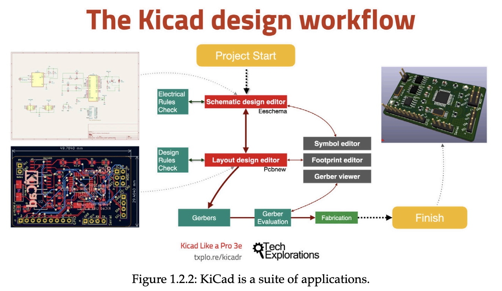

# MINTS PCB Onboarding with KiCAD  

This document is a **step-by-step guide** to help new MINTS members learn how to use **KiCAD** for PCB design.  
It covers setup, workflow, best practices, and useful resources.  

📖 For even more details, you can also consult the textbook: [KiCAD Like A Pro](https://www.gods69.com/download/KiCadLikeaPro3e_Course_Companion.pdf).  

---

# 1. Setting Up KiCAD  

## Installing KiCAD  

- Download the latest version from the [KiCAD website](https://www.kicad.org/download/).  
- Choose the **latest stable release** closest to your region.  
- On Linux, you can install via your package manager:  

```bash
sudo apt install kicad
```
for more details on installion, watch this [video](https://www.youtube.com/watch?v=szu8dJoyikA&list=PLn6004q9oeqGl91KifK6xHGuqvXGb374G)

## Setting Up Libraries

Libraries contain the symbols (schematic components) and footprints (physical pads and packages) needed for PCB design.
1. Clone the following commonly used libraries:

   - Digi-Key Symbol/Footprint Library

   - SparkFun Symbol/Footprint Library

2. Add libraries in KiCAD:

Go to:

 - Preferences → Manage Symbol Libraries

 - Preferences → Manage Footprint Libraries

Add all symbol files to the Symbol Library.
Add all footprint files to the Footprint Library.

Always verify the footprint dimensions against the part’s datasheet before ordering boards!

## Setting Up Plugins

KiCAD supports plugins to make design easier. Some recommended plugins:
 - PCBWay integration → automates the process of preparing and submitting PCB designs for manufacturing and assembly with the company PCBWay

 - Interactive HTML BOM → generates interactive BOM files for assembly.

 - Fabrication Toolkit → automates the process of generating manufacturing files for printed circuit boards (PCBs)
   
 - NextPCB → simplifies the PCB ordering process by allowing users to get real-time quotations and place orders for fabrication directly within the KiCad software

Install plugins via the Plugin & Content Manager (KiCAD 7+), or manually copy them into the ~/.local/share/kicad folder (Linux) or equivalent on Windows/macOS

# 2. General KiCAD Workflow Overview

Designing a PCB in KiCAD generally follows this four-stage workflow:

   1. Schematic Capture (Eeschema) – Draw your circuit.

   2. Footprint Assignment – Link schematic symbols to physical packages.

   3. PCB Layout (PCBNew) – Arrange components and route traces.

   4. Fabrication Outputs – Generate files for manufacturing and assembly.
      

# 3. Detailed Workflow

## A. Schematic Design

   1. Start a new project: File → New Project.

   2. Add components (A hotkey).

   3. Wire connections (W hotkey).

   4. Use labels (L) instead of drawing long wires.

   5. Annotate the schematic: Tools → Annotate Schematic.

   6. Run ERC (Electrical Rules Check) to catch errors.

Use global labels (like VCC, GND) for power nets instead of wiring them everywhere.
If you want your schematic to look more presentable, watch this [video](https://www.youtube.com/watch?v=szu8dJoyikA&list=PLn6004q9oeqGl91KifK6xHGuqvXGb374G)

## B. Assigning Footprints

Each schematic component must be assigned a physical footprint.

   - Open: Tools → Assign Footprints.
   - once here you can assign each symbol a footprint from your local footprint library
   - for more details on navigating the UI, watch this [video](https://www.youtube.com/watch?v=JMa9q4YhRDk)
   - Save your work!

Always double-check pinouts against datasheets — footprints are one of the most common mistakes in PCB design.

## C. PCB Layout (PCBNew)

1. Import schematic: Tools → Update PCB from Schematic.

2. Place components:

   - Group related parts together.

   - Keep connectors near board edges.

   - Place decoupling capacitors close to IC power pins.

3. Route traces:

   - Start with power and ground.

   - Use 45° angles, not 90°.

   - Keep traces short and direct.

4. Add ground plane: Add Filled Zone → GND.

   - Run DRC (Design Rule Check) to find clearance/trace width issues.

Route critical nets first (clocks, power lines, high-speed signals) before filling in general routing.

---

# 📦 4. Generating Gerber and BOM Files with Plugins  

In MINTS, we recommend using plugins to streamline the process of exporting **Gerber files** (for fabrication) and **BOM files** (for assembly).  

Two key plugins you should install and use are:  

- **NextPCB Plugin** → simplifies Gerber file generation and upload.  
- **Interactive HTML BOM (iBOM)** → generates an interactive bill of materials for assembly and debugging.  

---

## 🖨️ A. NextPCB Plugin for Gerber Files  

1. Open your PCB in **PCBNew**.  
2. Go to **Tools → External Plugins → Plugin and Content Manager**.  
3. Search for **NextPCB** and install the plugin.  
4. After installation, you’ll see a **NextPCB button** in PCBNew.  
5. Click it, and the plugin will:  
   - Automatically generate the required **Gerber files** and **drill files**.  
   - Package them into a `.zip` file.  
   - Open NextPCB’s website for order submission (optional).  

Even if you use a different manufacturer (e.g., JLCPCB, PCBWay), you can still use the NextPCB plugin just to generate the correctly formatted Gerber `.zip`.  

---

## 📑 B. Interactive HTML BOM (iBOM)  

The iBOM plugin creates a **clickable, interactive BOM** with board previews, which is extremely useful for assembling and testing boards.  

### Installing iBOM  

1. Open **Tools → External Plugins → Plugin and Content Manager**.  
2. Search for **InteractiveHtmlBom** and install it.  
3. Restart KiCAD if necessary.  

### Using iBOM  

1. In **PCBNew**, go to:  
   - **Tools → External Plugins → Interactive HTML BOM**  
2. Configure options:  
   - Select output as `HTML`.  
   - Include footprints, references, and component values.  
   - Enable highlighting when clicking components.  
3. Export → This will generate an `.html` file in your project directory.  
4. Open the `.html` file in your browser:  
   - Left pane → BOM list.  
   - Right pane → PCB preview (clicking a part highlights it).  

This is very useful when soldering by hand or debugging, since you can search for a component and instantly locate it on the PCB.  

---

