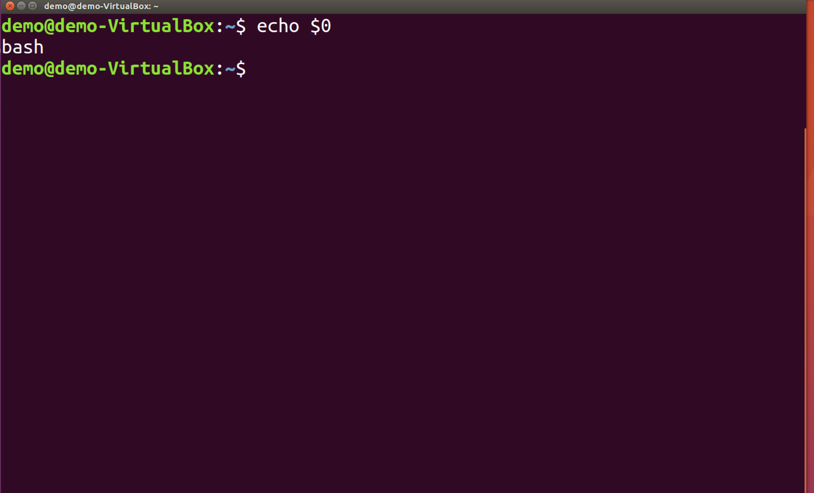
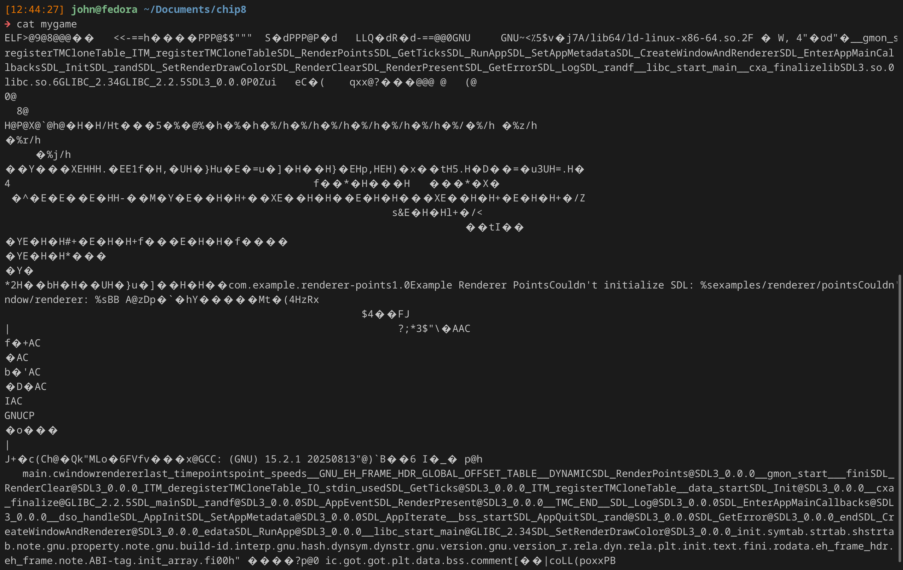

## Unix Basics

Welcome to the UNIX tutorial! **UNIX** is an operating system family that is fundamental to the MINTS-AI laboratory, and as you may have guessed, it is the backbone of the Linux operating system. It is also the backbone of the Mac and BSD operating systems. Basically any system that this lab uses is based on UNIX (or more specifically, is POSIX-compliant).

Here's some of the core principles that MacOS, Linux, and BSD follow:
-Everything is a file
-Each file/package should do one thing, and do it well.
-Support for multiple users; that is, the system can run many users running different tasks at once
-Wide hardware compatibility (less applicable to MacOS)

The main thing you need to understand is the terminal commands and the idea that everything is a file. In fact, one of the most common things we do in the lab is to access an I/O port (such as a USB). In UNIX, this is done by literally reading from a file that the operating system has assigned to the USB port (/dev/ttyUSB2, for instance).

Another nice thing about UNIX for developers is **packaging**. If you've worked with NodeJS or Python this shouldn't be an unfamiliar concept.

Packaging, at it's simplest, is just downloading a program or library directly through terminal by requesting the package from a distribution's provided **package manager**. There are many package managers, but the most common ones are **apt** (Advanced Packaging Tool) and **dnf** (Dandified YUM) for Linux systems, and **brew** for macOS.

Say you want to download Google Chrome on Linux, but you have a system with no internet browser. Without using terminal, you're essentially screwed. However, with a package manager, you can quickly and easily download Chrome. On an Ubuntu-based system (which we will be using), you can type

```sh
sudo apt install google-chrome
```

```sh
brew install google-chrome
```

**Note: if you are using MacOS, you will need to install brew yourself. You can either look it up (hopefully you have a browser), or you can run**
```sh
/bin/bash -c "$(curl -fsSL https://raw.githubusercontent.com/Homebrew/install/HEAD/install.sh)"
```
**in your terminal**

That example is actually quite common to the demands of the lab. Many of our embedded systems do not have any GUI. Essentially, when you access them, you will see something similar to this:



Almost every system in that the lab uses or deploys will have Linux with internet access, so if anything goes wrong you should be able to access a package manager and get a native package (or more likely, python package).

Let's dive more into UNIX command-line interface (CLI), AKA terminal.

---

## Command-Line Interface

I would encourage you to set up Windows Subsystem for Linux (WSL) if you're using Windows, or to dual-boot a Linux distro like Ubuntu. That way you can test these commands in your own terminal and get a feel for how they work. In other parts of the onboarding, you might have to connect to an SBC through SSH or DWService, so you can also practice there.

MacOS's terminal is already POSIX-compliant, so Mac users don't need any new software (except brew).

The Linux terminal is often referred to as CLI. There's a few (slight understatement) commands or packages that you need to know.

* ls
* cd
* clear
* pwd
* mv
* cp
* rm
* cat
* git
* apt
* sudo
* chmod
* scripts
* nano
* vim (or vi)
* mkdir
* touch
* curl
* grep
* man
* screen

---

### ls
Stands for "List"

List all sub-directories or files in a directory (in UNIX, a directory is just a folder).

### cd
Stands for "Change Directory"

Change to another directory. Formatting looks something like 
```sh
cd /
```
will take you to the root of the entire file system (which is / )

```sh
cd Documents/
```
will take you to the Documents directory (case-sensitive) inside whichever directory you're currently in. Essentially, you can use the absolute path by starting with / or ~, or the relative path by not.

### clear
Clears the terminal screen

### pwd
Stands for "Print Working Directory"

Prints the current absolute path that the terminal is in

### mv
Stands for "move"

Moves a file or directory from [Target] to [Destination directory], with the following syntax moving onboarding.txt into the Documents directory

```sh
mv onboarding.txt Documents/
```

Note that the Target can be either a directory or a file. I also added a / after the Documents to signify that it is a directory.

Also note that the mv command can be used to rename a file or directory

```sh
mv new_onboarding.txt old_onboarding.txt
```

### cp
Stands for "copy"

Copies a file to another directory. Has the same formatting as mv. If you want to copy an entire directory you need to use a **flag**. A flag just modifies the behavior of a command or package when run. In this case, you could run

```sh
cp onboarding/ Documents/ -r
```

which would copy the entire onboarding directory to the Documents directory *recursively*, so it would copy from the bottom of the file hierarchy up (i.e. going infinitely down the onboarding directory until it finds files, copying them, and then going back up until it's finished).

### rm
Stands for "remove"

Permanently deletes a file or directory. As with cp, you need a flag -r to remove a directory.

### cat
Stands for "concatenate"

Prints the contents of a file. 
```sh
cat file
```
You should generally try to avoid using *cat* on executable files because executable files are just binary, which could cause odd behavior in your terminal. For fun, here's what the output might look like:



### git
For the sake of brevity I'll assume you understand the basics of how git works. To use git in terminal, you need the following commands
```sh
git add [directory/file]
git clone [https/ssh key]
git rm [directory/file]
git branch
git checkout [branch]
```

### apt
The package manager used by Ubuntu-based Linux distros. All of our microcontrollers use this package manager. The necessary commands are:

```sh
sudo apt update
sudo apt install [package-name-no-spaces]
sudo apt remove [package-name-no-spaces]
```

### sudo
Stands for "super user do"

Basically gives the process that you're creating root (admin) privileges. In the apt section, we had to use *sudo*. This is because adding or removing packages is considered a sensitive action that requires user permission to do. So if you run a command and it gives a permissions error, you should stop to think if what you are about to do is safe, and if so then to run it again with *sudo*

### chmod
Stands for "change mode"

Alters the permissions that a process has. Say you created a script and want to be able to run it, you can do

```sh
chmod +x my-script.sh
```

+x is the permissions we're adding, which in this case is eXecutable permissions.

## Running scripts
This isn't a package or UNIX command. It's just how you start a script or executable (provided that it has executable permissions).

To run a script called *script.sh* or an executable called *object* in the same directory that you are in:

```sh
./script.sh
./object
```

## nano
A user-friendly CLI text editor. Think of it like a Notepad app.

## vi / vim
A less user-friendly CLI text editor. Generally, every version of linux at least has vi installed for a text editor. If you can't find nano in a system, you can try vi or vim.

## mkdir
Stands for "make directory". 

```sh
mkdir Documents/new_directory
```
Makes a new directory called *new_directory* in relative path Documents/

## touch
Makes a new file in the current directory

```sh
touch new_file
touch new_text.txt
touch new_script.sh
```

## curl
A way to make requests over internet. This command is heavily dependent on flags to change it, so if you need to use curl, you can look into the flags yourself.

## grep
Pattern-finding command. If I wanted to find all lines with the word "hello" from the file *example.txt*, I could run

```sh
cat example.txt | grep hello
```

This uses a **pipe operator** to send the output from *cat example.txt* into *grep hello*

## man
Short for "manual"

If installed, *man* will show you a lot of the prevalent information for a command.

```sh
man grep
```

## screen
Watch for serial output from a specific port. If I wanted to watch the output from a USB, which I've found to be at /dev/ttyUSB0, and the device is outputting at a baudrate of 9600bps, I could run
```sh
screen /dev/ttyUSB0 9600
```

---
# File system

The file system of linux is fairly simple. 
The root directory is the top-most directory in the hierarchy. Most things here are system tools (remember, everything is a file in linux). / represents the root directory. Here, you can find many important directories 
* */bin* for binary files (programs like sudo, mv, cp, etc.)
* */etc* for configuration files
* */dev* for device files
* */home* for user directories
* Among others!

~ represents the user's home directory. The home directory is where you'll find personal files, like Pictures, Documents, Downloads, Music, etc. 

If you want to go to your own user's Downloads directory, you could go to
```sh
/home/[YOUR_USERNAME]/Downloads
```
or you could go to
```sh
~/Downloads
```

---

# Final tips

There's some nice things to know that can save you time.
* Tab auto-completion is your friend. Say you download a text file called Wifi_Module_ESP8266_WRL-13678.txt. If you want to *cat* that file. If you're in the same directory as the file, you can type
```sh
cat Wifi_
```
and then press TAB to autocomplete the command
* You can use operators to help you. The previously-mentioned **pipe operator** can be useful, but you can also use the **wildcard**. If you want to list all files in the home directory that have a .sh file extension, you can run
```sh
ls ~/*.sh
```
* . is used to mean "current directory" (i.e. *ls* is the exact same as *ls .* )
* Inside Linux terminal, copy-paste is CTRL+SHIFT+C and CTRL+SHIFT+V . On Mac, it's CMD + C and CMD + V.
* You can use the up and down arrows to use previous commands.

---

# Project
As a quick exercise, do the following entirely through CLI

Create a new directory inside your Documents/ directory, and name it "mintsLab" (it would probably be in your interest to keep a lot of things lowercase, because the terminal is case-sensitive).

Inside this directory, clone the methaneSensing git repository from the MINTS-AI organization on GitHub. The MINTS organization's name is mi3nts on GitHub.

Inside the newly-cloned methaneSensing/firmware/xu4Mqtt directory, find all lines with the string "methane" from every .py file. Put all of these lines in a new file called matches.txt in ~/Documents/methaneSensing. You can use pipe operators to do this in a single command, or you can do this in multiple commands. Either works, as long as you can do it.

***And that's it! You're basically a master of Linux! Well, maybe not yet, but I encourage you to find some other practices online or challenge yourself to something you can think of with the commands you've been given.***
